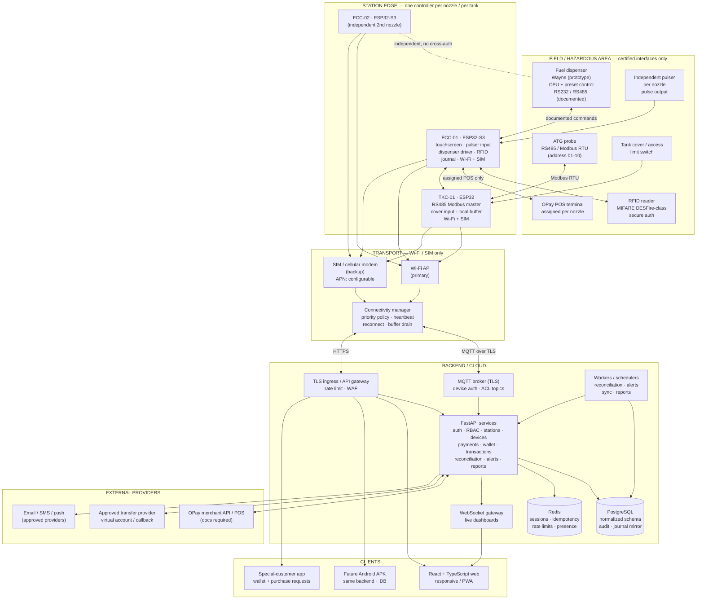
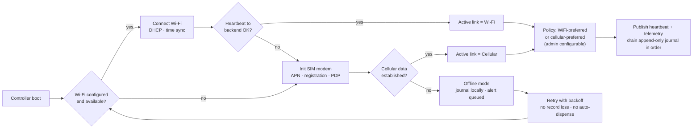
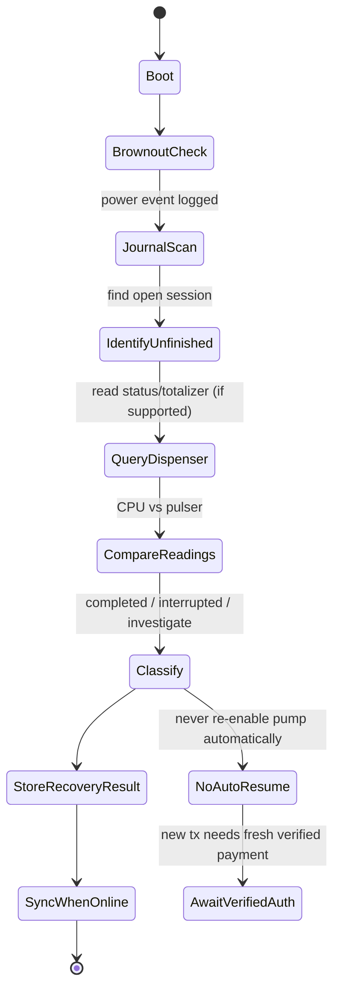

# 01 — System Architecture

## 1. Architecture summary

VISUAL EYES 360 is a layered, multi-station system:

1. **Field layer** — dispensers and their CPUs, independent pulsers, ATG probes, tank cover sensors, RFID readers, OPay POS terminals.
2. **Edge controller layer** — one ESP32-S3 FCC per nozzle; one ESP32 tank controller per tank. Each controller owns its local journal and its Wi-Fi/SIM uplink.
3. **Transport layer** — MQTT over TLS for device telemetry/commands, HTTPS REST for management clients, WebSocket for live dashboard push.
4. **Backend layer** — FastAPI services with PostgreSQL, Redis (sessions/rate limits/idempotency), and an MQTT broker. The backend is the only authority for payments, wallets, permissions and authorization.
5. **Client layer** — responsive React web app (also the future Android wrapper/Capacitor target), and a special-customer mobile experience using the same APIs.

Design rules applied throughout: database-driven multi-station model, modular drivers, no hardcoded station/pump/nozzle, no secrets in firmware or APK, and explicit separation of simulation from real integration.

## 2. Complete system block diagram



## 3. Trust boundaries

| Boundary | Rule |
|---|---|
| Field → FCC | Manufacturer-approved interface only. Safety interlocks untouched. Pulse input is isolated/protected. |
| FCC → Backend | Device certificate/token, mutual TLS where broker supports it, signed commands, replay protection. |
| Client → Backend | JWT access + rotating refresh token, RBAC + station scope enforced server-side on every request. |
| Backend → Provider | Provider secrets live only in backend secret store; callbacks verified (signature + amount + reference + merchant). |
| Manager → System | Permissions delivered by backend; UI hides controls but backend rejects unauthorized calls independently. |

## 4. Wi-Fi and SIM-only communication architecture



Requirements implemented by this layer:

- Wi-Fi provisioning, reconnection and signal reporting.
- Modem init, SIM presence, network registration, APN/PDP activation, signal strength (RSRP/CSQ where supported).
- Configurable priority policy (default Wi-Fi preferred, SIM backup).
- Heartbeat, timeouts, backoff, link-quality reporting to backend.
- Offline journaling and ordered replay after reconnect, exactly-once semantics via transaction/sync IDs.
- **No Ethernet path exists** in the design — not primary, not failover.

> Modem model, Nigerian band support, APN values and AT command set are unresolved — see `08-open-items.md`.

## 5. Backend architecture (Phase 6)

```
backend/
├── app/
│   ├── main.py                 # app factory, middleware
│   ├── core/                   # config, security, hashing, errors
│   ├── db/                     # session, base, migrations
│   ├── modules/
│   │   ├── auth/               # login, tokens, first-admin setup
│   │   ├── users/              # admin/manager accounts, permissions
│   │   ├── stations/           # stations, states/LGAs
│   │   ├── devices/            # FCC/tank registration, provisioning
│   │   ├── dispensers/         # pumps, nozzles, drivers
│   │   ├── payments/           # OPay, transfer, callbacks, idempotency
│   │   ├── rfid/ wallets/ customers/ fleets/
│   │   ├── transactions/       # sessions, CPU+pulser records
│   │   ├── reconciliation/     # fuel + tank engines
│   │   ├── prices/ alerts/ reports/ audit/
│   │   └── iot/                # MQTT client, commands, telemetry ingest
│   ├── schemas/                # Pydantic request/response models
│   └── ws/                     # WebSocket channels
├── migrations/                 # Alembic
└── tests/
```

Key patterns: service layer + repository layer, Pydantic validation on all inputs, dependency-injected permission and station-scope guards, outbox pattern for device commands, and idempotency keys on every externally-triggered mutation.

## 6. Web and Android architecture (Phases 7–8)

- **Web:** React + TypeScript, Vite, component library, React Query for server state, WebSocket for live views, responsive layout with light/dark themes. Route guards consume backend-provided permissions; direct URL access to an unauthorized module renders an access-denied state and the backend still rejects the API calls.
- **Android:** same REST/WebSocket APIs and same database. Preferred path is a thin native/Capacitor shell around the responsive app, with native plugins for secure token storage and push notifications. No second business database, no hardcoded credentials, no role escalation on mobile.
- **Customer app:** dedicated role (`SPECIAL_CUSTOMER`) with wallet, purchase requests, card status and notifications; it never authorizes dispensing directly.

## 7. Security architecture (Section 20)

- Argon2id password hashing; unique User ID login; generic failure message.
- JWT access tokens (short TTL) + rotating refresh tokens with revocation on logout/deactivation.
- Login throttling/lockout, rate limiting at gateway and app layer.
- RBAC with per-module actions plus per-station row scope enforced in SQL queries.
- Device identity: per-device credentials/certificates, provisioning approval, revocation list; no shared permanent password.
- TLS everywhere; MQTT authenticated with topic ACLs; signed commands with expiry and nonce; replay protection.
- Idempotency keys for payments, authorizations, wallet reservations and journal sync.
- Secrets in backend secret manager only; never in ESP32 firmware or APK.
- Tamper-evident audit log; managers cannot delete or edit it.
- Signed firmware updates where the chosen platform supports them.

## 8. Industrial safety architecture (Section 21)

- Field wiring uses certified interfaces, barriers, surge/transient protection, isolation, grounding/bonding and approved enclosures.
- ESP32/STM32 dev boards are **not** intrinsically safe — no uncertified board in a classified area.
- No bypass of dispenser safety interlocks or station ESD.
- Preset control goes through the manufacturer-approved enable/control path.
- Any independent shutdown is a separate, safety-rated, qualified-engineer design.
- Fail-safe defaults: on comms fault, sensor fault or power loss, no new authorization is issued.

## 9. Offline and power-failure recovery (Section 14)



Guarantees: append-only journal, atomic record writes with integrity checks, RTC/time recovery, brownout detection, watchdog, duplicate-sync protection, and no authorization without fresh verified payment. Ambiguous outcomes are marked for investigation, never silently "successful."
