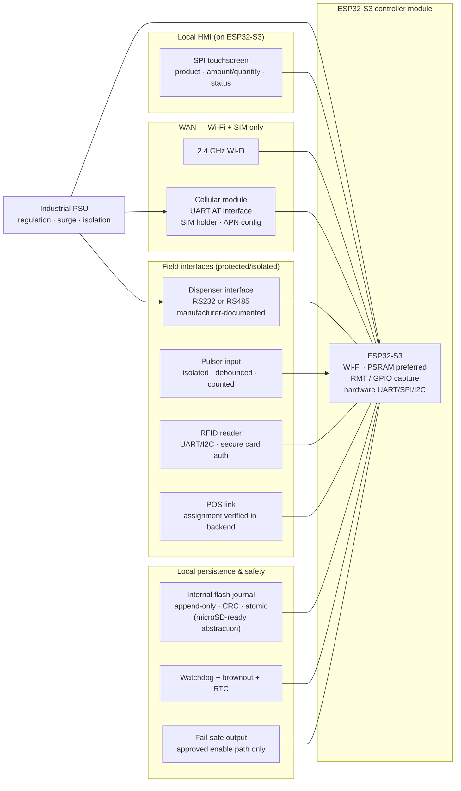
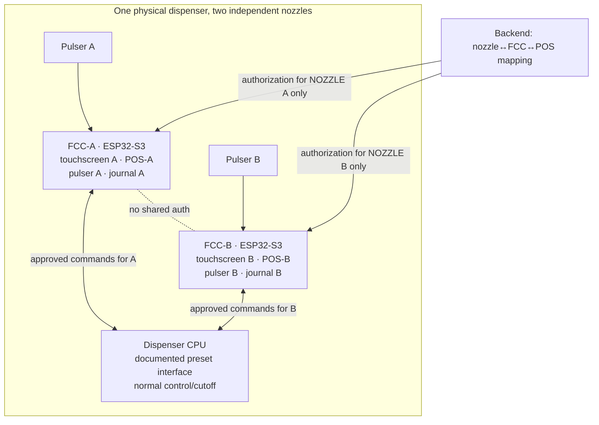
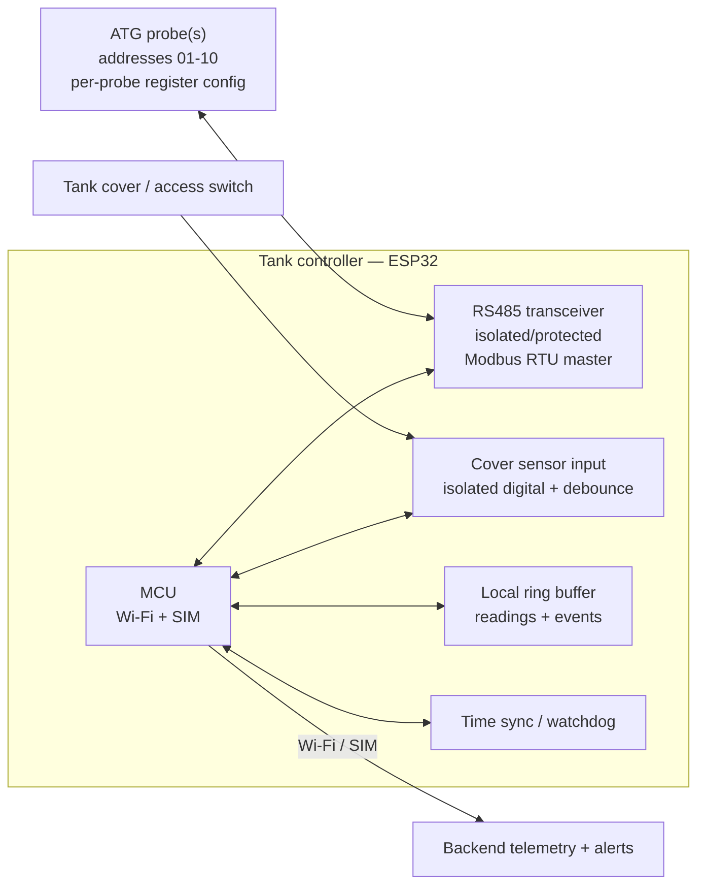
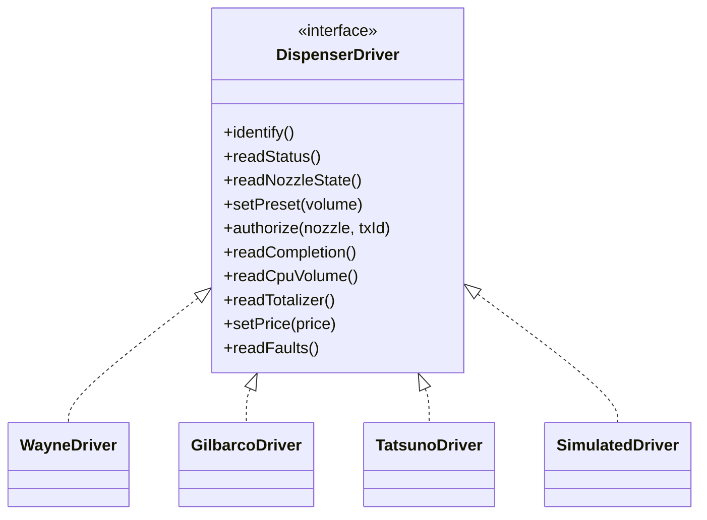

# 02 — Hardware Architecture

This document defines hardware *structure and interfaces*. Exact part numbers, pin numbers and electrical ratings are deliberately left as **selection outputs** until the board, modem, dispenser interface and probe datasheets are supplied. See `08-open-items.md`.

## 1. One-nozzle FCC architecture (prototype unit)



Per-nozzle identity and records: unique device ID, station/dispenser/nozzle assignment, assigned POS, own pulser channel, own transaction history, firmware version, comms status, fault diagnostics.

### Peripheral allocation method (final table required in Phase 2)

Reserve resources by interface first, then map to physical GPIO after board selection:

| Interface | Required resource | Notes / constraint |
|---|---|---|
| Cellular modem | 1 hardware UART (AT commands) + control lines | Dedicated UART; modem power key, reset, SIM detect, status lines |
| Dispenser link | 1 UART (RS232) **or** 1 UART + direction control (RS485) | Isolated transceiver; exact interface from dispenser docs |
| Touchscreen | SPI (display) + touch controller (SPI or I2C) + reset/backlight/CS/IRQ | Directly on ESP32-S3, never on STM32 |
| RFID reader | UART or I2C | Secure card auth (not UID-only) |
| Pulser input | RMT capture or interrupt-capable GPIO with signal conditioning | Isolated, debounced, no missed pulses; calibration factor configurable |
| Local storage | Internal flash partition (journal) | Abstraction must allow microSD swap later |
| POS | Via backend-assigned terminal; link mediated by firmware logic | Prevent cross-nozzle authorization |
| Debug | USB/JTAG + log UART | Programming and diagnostics |

Conflict checks to perform in Phase 2: UART count vs modem+dispenser+RFID+log; SPI CS lines; I2C address collisions; ADC use; PSRAM availability for UI buffers; power budget during modem transmit bursts.

## 2. Double-nozzle dispenser architecture



Rules:

- Two FCCs, two POS terminals, two pulser channels, two journals.
- Authorization token is bound to transaction ID + station + dispenser + nozzle + FCC + POS. A token for A cannot drive B even if the request is manipulated.
- Dispenser CPU retains normal control; FCCs request presets through the documented interface.
- Shared dispenser communication must be arbitrated so commands for one nozzle cannot be applied to the other.

## 3. Tank controller architecture (one per tank)



Capabilities: device registration, probe polling with per-probe config (address, baud, register map), calibration-chart conversion, cover-open/close events with duration and authorized-maintenance tagging, alarm states, local buffering during outages, heartbeat, firmware version, remote config, diagnostics. No Ethernet.

## 4. ESP32-S3 recommendation and peripheral arrangement

**Recommendation:** ESP32-S3 module with PSRAM (e.g., an ESP32-S3-WROOM class module on a carrier meeting GPIO needs), chosen because:

- PSRAM headroom for a responsive touchscreen UI.
- Hardware Wi-Fi satisfies the primary WAN requirement.
- Multiple hardware UARTs/SPI/I2C allow modem + dispenser + RFID + display simultaneously.
- RMT/GPIO capture can handle typical fuel-pulser pulse rates; external conditioning handles debounce/isolation.
- Mature toolchain (ESP-IDF) for journaling, TLS, OTA.

Final selection must be confirmed against: available GPIO after module choice, flash size, PSRAM, number of UARTs, RMT channels, and modem power requirements. This is a Phase 2 gate.

## 5. STM32 vs hardware pulse counting — engineering recommendation

**Recommendation for the first prototype: do NOT add an STM32.** Use ESP32-S3 pulse capture (RMT or interrupt-based with conditioning) plus an isolated pulse input; validate accuracy on the bench.

| Option | Pros | Cons | Verdict |
|---|---|---|---|
| ESP32-S3 RMT/interrupt capture | Lowest BOM and complexity; one firmware; enough for typical low-rate pulser pulses; easy journaling next to transaction logic | Shared CPU with UI/network; requires careful ISR and conditioning; must prove no missed pulses under load | **Prototype choice** |
| Dedicated external counter IC | Deterministic counting, offloads MCU, simple I2C/SPI read | Extra part, extra driver, still needs validation | Good fallback if bench test fails |
| STM32 real-time co-controller | Hardware timer capture, deterministic events, independent watchdog, fast fault detection | Second firmware, second toolchain, UART/SPI protocol to maintain, cost, complexity, more failure modes | Defer; add only if tests show missed pulses or safety case demands independent capture |

STM32 may be introduced later as a real-time subsystem (UART/SPI to ESP32-S3) if pulse-accuracy tests, deterministic fault detection or an independent watchdog requirement justify it. The touchscreen never moves to it, and it never becomes the main controller.

## 6. Dispenser CPU + independent pulser model

```mermaid
sequenceDiagram
  participant B as Backend
  participant F as FCC (ESP32-S3)
  participant D as Dispenser CPU
  participant P as Independent Pulser
  B->>F: Authorized tx (preset qty, nozzle-bound ID)
  F->>D: Preset request (documented command)
  D-->>F: Ready
  D->>D: Normal control + cutoff
  P->>F: Pulses (independent)
  D-->>F: CPU volume / totalizer / completion
  F->>F: Pulser volume = count × calibration
  F->>B: CPU volume, raw count, calibration, pulser volume, times
  B->>B: diff = CPU − Pulser; abs; %; threshold check
```

Reconciliation formula and records:

```
CPU Volume      = dispenser CPU reported volume
Pulser Volume   = raw_pulse_count × calibration_factor
Difference      = CPU Volume − Pulser Volume
Absolute Diff   = |Difference|
% Difference    = (Absolute Diff / reference volume) × 100
```

Retained fields: transaction ID, station, dispenser, nozzle, product, start/end time, raw count, calibration factor, CPU volume, pulser volume, difference, percentage difference. Initial configurable investigation threshold: **0.49 L or greater**. Statuses: Normal, Warning, Critical (investigation required), Under review, Confirmed incident, False alarm/resolved. Discrepancy ≠ theft; sensor/calibration/comm faults are considered first.

## 7. Dispenser driver abstraction (no invented commands)



`SimulatedDriver` exists for bench tests and is always labelled as simulation. `WayneDriver` remains a stub until the exact model, CPU board, comm board, interface and protocol document are provided. Price changes only via documented commands and are confirmed by the dispenser before being marked successful.
