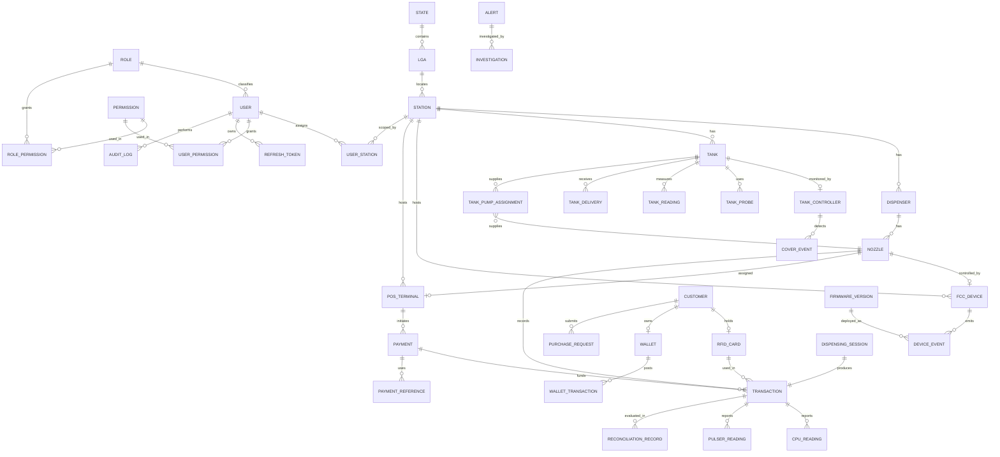

# 03 — Database Architecture (PostgreSQL)

Normalized, multi-station, high-volume schema. UUID primary keys, `created_at`/`updated_at` on all tables, soft delete where useful, status enums, FKs, indexes, and constraints. Wallet and authorization operations run inside atomic transactions with idempotency keys.

## 1. Entity relationship diagram (core)

## 2. Identity, roles and access (Section 28.13)

| Table | Key fields | Purpose |
|---|---|---|
| `users` | id, user_id (unique), full_name, role_id, phone, email, password_hash, status, must_change_password, last_login_at | Login identity. Roles: SUPERIOR_ADMIN, MANAGER, SPECIAL_CUSTOMER (device/service accounts separate). |
| `roles` | id, code, name | Fixed role catalogue; new roles can be added. |
| `permissions` | id, module_code, action_code, description | Dynamic permission catalogue; not hardcoded in frontend. |
| `role_permissions` | role_id, permission_id | Defaults for a role. Superior Admin bypass via explicit `is_super_admin` flag, not a wildcard row. |
| `user_permissions` | user_id, permission_id, effect (GRANT/DENY) | Per-manager overrides set by Superior Admin. |
| `user_stations` | user_id, station_id, scope (ALL/SELECTED) | Station row scope enforced in queries. |
| `login_sessions` | id, user_id, token_jti, ip, user_agent, expires_at, revoked_at | Session tracking. |
| `refresh_tokens` | id, user_id, token_hash, family_id, expires_at, revoked_at, used_at | Rotating refresh with reuse detection. |
| `password_reset_tokens` | id, user_id, token_hash, expires_at, used_at | Secure reset. |
| `account_status_history` | id, user_id, from_status, to_status, actor_id, reason | Status audit. |
| `audit_logs` | id, actor_id, action, entity_type, entity_id, before_json, after_json, ip, user_agent, created_at | Tamper-evident (hash chain optional). Managers cannot modify. |

Unique index on `lower(user_id)`. No plaintext passwords anywhere.

## 3. Geography and stations

`states`, `lgas` (state_id FK), `stations` (station_id/code unique, name, address, lga_id, gps, contact, manager_user_id, status, registered_at), `locations`/map metadata, `fuel_products` (PMS/AGO/DPK + future), `station_products` (pricing per station).

## 4. Equipment

| Table | Notes |
|---|---|
| `dispensers` | station_id, manufacturer, model, protocol, interface, serial, status, totalizer |
| `nozzles` | dispenser_id, nozzle_number, product_id, price, status |
| `fcc_devices` | unique device_id, serial, firmware_version, station/dispenser/nozzle assignment, pos_terminal_id, network_type, wifi/sim status, signal, heartbeat_at, storage/fault/status |
| `pos_terminals` | unique terminal_id, provider, serial, station, status, config |
| `pos_assignments` | nozzle_id ↔ pos_terminal_id, active period, audit |
| `tanks` | station_id, product_id, capacity_l, shape, calibration_chart_ref, status |
| `tank_controllers` | unique device_id, tank_id, firmware, network, heartbeat |
| `tank_probes` | tank_id, address (01–10), protocol, baud, register_map_ref, status |
| `tank_pump_assignments` | tank_id ↔ nozzle_id; product compatibility enforced; audited |
| `firmware_versions` | component, version, checksum/signature, released_at |

## 5. Customers, RFID, wallets, fleet

- `customers`: categories, KYC fields, status, credit/limit config.
- `rfid_cards`: unique card identity, technology, secure credential ref, customer_id, status (active/suspended/blocked/lost), issued/replaced_at. UID alone is never proof of identity.
- `wallets`: customer_id unique, available_balance, reserved_balance, currency, limits, status.
- `wallet_transactions`: wallet_id, type (FUND/RESERVE/RELEASE/DEBIT/REFUND), amount, ref, idempotency_key, balance_after, created_at.
- `purchase_requests`: customer_id, station/nozzle/product, amount/quantity, status (PENDING/AUTHORIZED/EXPIRED/COMPLETED/CANCELLED), expires_at.
- `fleets`, `vehicles`, `drivers`: organization, reg number, type, driver, limits (amount/quantity), odometer, consumption, linked customer/org.

Atomic wallet rule: reserve inside `BEGIN ... SELECT ... FOR UPDATE` on the wallet row; release/debit in the same transaction as the final transaction record; unique idempotency key prevents double charging.

## 6. Payments and transactions

| Table | Notes |
|---|---|
| `payments` | id, tx_id, provider, reference (unique), method (POS_CARD/TRANSFER/WALLET), terminal_id, amount, currency, status, provider_response, authorized_at, refund_status |
| `payment_references` | payment_id, reference unique, expires_at, status; used for transfers/virtual accounts |
| `dispensing_sessions` | id, nozzle_id, fcc_id, auth_token_id, state, started_at, ended_at |
| `transactions` | unique tx_id, station/dispenser/nozzle/fcc/pos, customer/card, payment_id, product, unit_price, requested_qty/amount, cpu_volume, pulser_volume, raw_pulse_count, calibration_factor, difference, pct_difference, start/end, payment_status, reconciliation_status |
| `cpu_readings`, `pulser_readings` | raw time-series linked to transaction (separate, never summed as two sales) |
| `device_commands` | id, target_device, requested_by, payload, expires_at, status, ack_at, result |
| `device_events`, `power_events`, `config_changes`, `price_history`, `maintenance_records` | audit/telemetry |

Idempotency: unique keys on `tx_id`, `payment.reference`, `device_command.id`, and journal sync `(device_id, sequence_no)`. Duplicate callbacks and duplicate sync replays are no-ops.

## 7. Reconciliation, inventory, alerts

- `tank_readings`: controller_id, probe_id, level, water, temp, volume, ullage, capacity, alarm/fault/status, timestamp.
- `tank_deliveries`: tank_id, qty, delivery_ref, time, evidence.
- `reconciliation_records`: scope (FUEL/TANK), period, opening, deliveries, cpu_sales, pulser_volume (informational), expected_closing, actual_atg_closing, variance, tolerance, assigned_nozzles, alarms, status.
- `alerts`: type, severity, station/tank/device, status (OPEN/ACKED/UNDER_REVIEW/RESOLVED/FALSE_ALARM), assigned_to.
- `investigations`: alert_id, findings, resolution, comments, closed_by, audit trail.
- `notification_records`: channel, recipient, payload, status.

## 8. Indexing and integrity

- Indexes: `(station_id, created_at)`, `(nozzle_id, created_at)`, `(fcc_id, status)`, `(payment_id, status)`, `(tank_id, recorded_at)`, `(actor_id, created_at)` on audit, GIN on JSON response columns where queried.
- Constraints: product compatibility on tank↔nozzle assignment, positive amounts/quantities, non-negative balances, unique active POS assignment per nozzle, unique active card per customer.
- Soft delete on master data (stations, dispensers, customers); hard append-only on journals, audit and readings.
- Partitioning plan for `transactions`, `tank_readings`, `cpu_readings`, `pulser_readings` by month once volumes justify it.

> A visual ERD is embedded above; a full generated diagram with all attributes will be produced from migrations in Phase 6.
