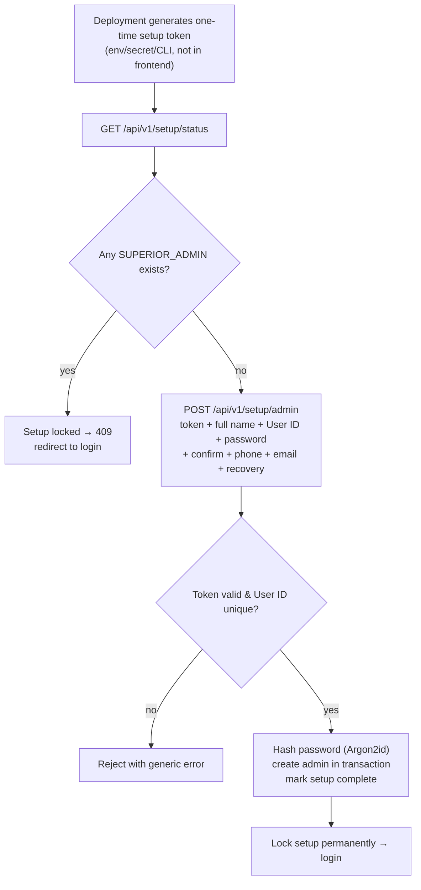
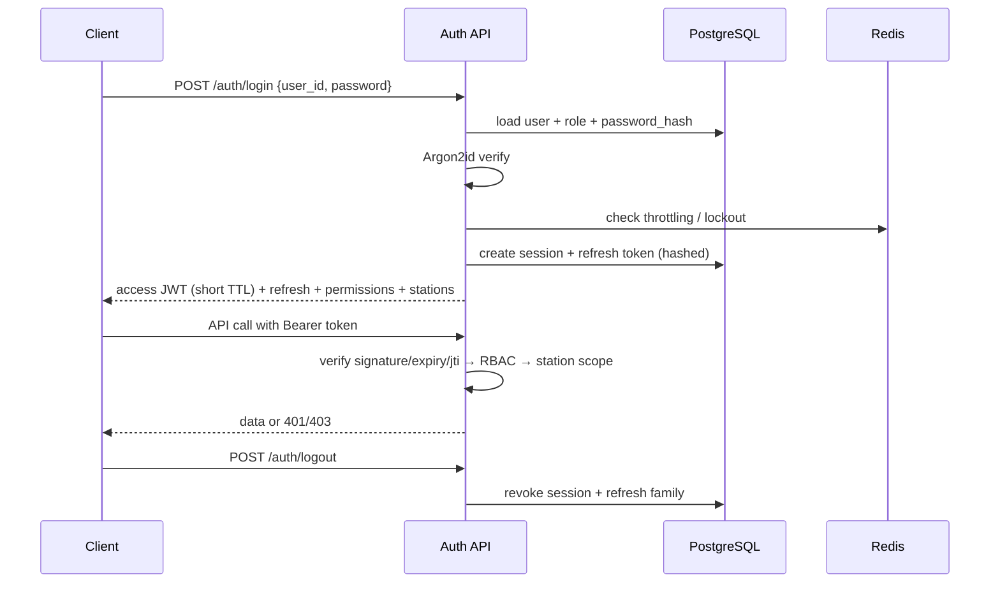

# 04 — Authentication, RBAC and User Management

## 1. Login page design (Section 28.2)

| Element | Behaviour |
|---|---|
| User ID | Text input, unique ID (not email). |
| Password | Masked with show/hide toggle. |
| Login button | Disabled while submitting; loading indicator. |
| Forgot password | Links to secure reset flow (token to verified phone/email). |
| Errors | Single generic message: "Invalid credentials" — never reveals whether ID or password was wrong. |
| Rate limit | Throttled after repeated failures; temporary lockout; CAPTCHA only via approved provider if needed. |
| Post-login | Backend returns access token, permissions and station scope; app routes to correct dashboard. |

No admin credentials in frontend. No plaintext passwords stored.

## 2. First Superior Administrator setup (Sections 28.3)

Security rules: setup endpoint refused once an admin exists; token is single-use and deployment-generated; no public admin registration; recovery info stored encrypted.

## 3. Account types (Sections 28.4–28.5)

| Type | Authority |
|---|---|
| **SUPERIOR_ADMIN** | Full system: stations, devices, tanks, customers, RFID/wallet, fleet, prices, transactions, reconciliation, alerts, reports, settings, audit, firmware — and full user management (create/edit/suspend/reset managers, assign permissions and stations). |
| **MANAGER** | Only permissions explicitly granted, only within assigned stations. |
| SPECIAL_CUSTOMER | Customer app only: wallet, purchase requests, card status, history, notifications. Cannot manage system modules. |

## 4. Manager creation workflow (Section 28.6)

Path in UI: **Settings → User Management → Create Manager**.

Fields: full name, unique Manager ID, initial password + confirm, phone, email, station assignment (one/multiple/all-explicit), status, permission configuration.

Only Superior Admin can call `POST /api/v1/users/managers`. No public route, no self-registration. Multiple managers supported (e.g., Abuja, Lagos, Kaduna, selected-stations). Changes to permissions/stations apply immediately on the next authorization check; deactivation revokes sessions.

## 5. Permission matrix (Section 28.7)

Actions: **N** = No Access, **V** = View, **C** = Create, **E** = Edit, **M** = Manage, **A** = Approve, **X** = Export. Only applicable actions are shown per module.

| # | Module | Available actions |
|---|---|---|
| 1 | Dashboard | V |
| 2 | Station Management | V, C, E, M |
| 3 | Dispenser Management | V, C, E, M |
| 4 | Nozzle Management | V, C, E, M |
| 5 | FCC Device Management | V, C, E, M |
| 6 | Tank Management | V, C, E, M |
| 7 | Tank Controller Management | V, C, E, M |
| 8 | Tank-to-Pump Assignment | V, C, E, M, A |
| 9 | Customer Management | V, C, E, M |
| 10 | RFID Management | V, C, E, M, A |
| 11 | Wallet Management | V, C, E, M, A |
| 12 | Fleet Management | V, C, E, M |
| 13 | Vehicle Management | V, C, E, M |
| 14 | POS Terminal Management | V, C, E, M |
| 15 | Payment Management | V, C, E, M, A, X |
| 16 | Fuel Transactions | V, X |
| 17 | Pulser Monitoring | V, X |
| 18 | Dispenser Reconciliation | V, M, A, X |
| 19 | Tank Reconciliation | V, M, A, X |
| 20 | Fuel Price Management | V, C, E, A |
| 21 | Alerts & Notifications | V, C, E, M, A |
| 22 | Reports | V, X |
| 23 | Maintenance Management | V, C, E, M |
| 24 | User Activity | V, X |
| 25 | Device Configuration | V, C, E, M, A |
| 26 | System Settings | V, E, M |

Example profiles: **Station Operations** (dashboard/station/dispensers/transactions/tanks/alerts/reports view + acknowledge + export, no prices/POS/users/settings); **Fuel & Inventory** (tanks, reconciliation, deliveries, transactions, reports); **Finance** (payments, transactions, wallet records, payment reports; no dispenser control/device config/users). Any combination is configurable; View-only never implies edit/approve/execute.

## 6. Station-based restriction (Section 28.8)

- `user_stations` defines SELECTED station IDs or explicit ALL.
- Every station-scoped query is filtered in the repository: `WHERE station_id IN (:allowed_stations)` unless scope=ALL.
- Backend verifies station ownership for device IDs, nozzle IDs, tank IDs and payment records — manipulating a URL/body/ID cannot escape scope.
- Frontend filtering is a usability feature, not a security control.

## 7. Separate dashboards (Section 28.9)

After login the backend supplies `role`, `permissions[]`, `stations[]`. The app builds navigation from that payload. Superior Admin sees all modules; Manager sees only allowed modules/stations. Direct navigation to a forbidden route renders an access-denied view, and the corresponding API calls return 403.

## 8. Backend auth architecture (Sections 28.10–28.12)

Controls: Argon2id, short-lived access tokens, rotating refresh with reuse detection, token revocation on logout/deactivation, login throttling/lockout, rate limiting, password reset tokens, forced password change on first manager login (backend blocks all other endpoints until completed), optional TFA, audit logging, and backend re-validation of permissions on every request.

## 9. API endpoints (Sections 28.11, 29.11)

| Method | Endpoint | Permission |
|---|---|---|
| GET | `/api/v1/setup/status` | public (locked after first admin) |
| POST | `/api/v1/setup/admin` | one-time setup token |
| GET | `/api/v1/setup/status` | public |
| POST | `/api/v1/setup/admin` | one-time setup token |
| POST | `/api/v1/auth/login` | public |
| POST | `/api/v1/auth/refresh` | valid refresh token |
| POST | `/api/v1/auth/logout` | authenticated |
| GET | `/api/v1/auth/me` | authenticated |
| POST | `/api/v1/auth/password/change` | authenticated |
| POST | `/api/v1/auth/password/forgot` | public (throttled) |
| POST | `/api/v1/auth/password/reset` | reset token |
| POST | `/api/v1/users/managers` | `users:create` |
| GET | `/api/v1/users` | `users:view` |
| PATCH | `/api/v1/users/{id}` | `users:edit` (also carries permissions and station_ids) |
| POST | `/api/v1/users/{id}/password/reset` | `users:manage` |
| POST | `/api/v1/users/{id}/status` | `users:manage` |
| GET | `/api/v1/permissions/catalogue` | `users:view` |
| GET | `/api/v1/audit-logs` | `audit:view` |
| GET | `/api/v1/stations` | `stations:view` + station scope |
| POST | `/api/v1/stations` | `stations:create` |

## 10. User management UI and audit trail (Section 28.11)

Table columns: full name, User ID, account type, assigned stations, permissions, status, last login, created/modified. Actions: create manager, edit, reset password, change permissions, change stations, activate/suspend/deactivate, view activity. Every action writes an `audit_logs` row with actor, action, entity, before/after, time, IP/session. Managers cannot erase or modify audit history.

## 11. Future Android APK (Sections 28.14, 29.15)

Same endpoints, same tokens, same backend payload. No hardcoded admin account, no separate DB, no extra mobile-only permissions. A permission change made by the Superior Admin applies to web and APK on the next authorization check. Responsive web app is structured as a PWA/Capacitor-ready shell so packaging later does not rewrite business logic.
