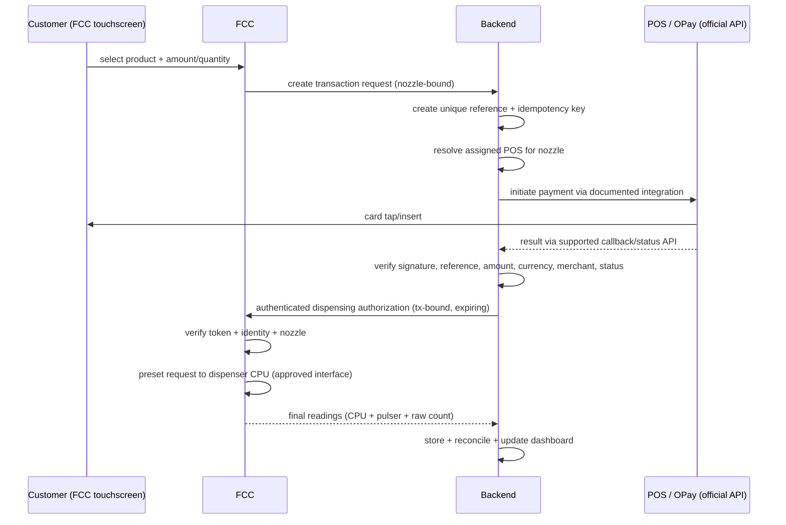

# 05 — Integration Workflows and Documentation Gaps

## 1. Payment / OPay / POS architecture (Section 7)



**Absolute rule:** only an independently verified successful provider result, validated by the backend, authorizes dispensing. Screenshots, receipts, customer messages, frontend success states, pending/unverified references and reused authorizations never authorize fuel. Validate reference, amount, currency, merchant identity, status and transaction relationship. Idempotency prevents duplicate authorization.

**POS constraint:** a normal OPay payment API does not automatically control a physical POS terminal. Whether remote initiation, terminal identification, status callbacks or an approved SDK exist depends on the specific terminal model and merchant account. If unsupported, this must be stated and an approved alternative requested — never fabricated.

**Bank transfer:** supported through an approved provider product using unique references/dynamic virtual accounts, expiry, and provider confirmation. Pending transfer never dispenses.

**Records stored:** payment ID, transaction ID, provider, reference, POS terminal, amount, currency, method, customer, station, nozzle, provider response, status, authorization time, dispensing status, refund status.

> BLOCKED until official OPay merchant docs, sandbox credentials, callback format, terminal capabilities and transfer-provider docs are supplied. See `08-open-items.md`.

## 2. RFID special-customer wallet workflow (Section 8)

```mermaid
sequenceDiagram
  participant APP as Customer app
  participant B as Backend
  participant F as FCC at nozzle
  participant D as Dispenser CPU
  APP->>B: login, select station/product/nozzle, qty/amount
  B->>B: validate account, card status, wallet balance
  B->>B: create PENDING purchase request
  APP->>F: customer taps registered RFID card
  F->>B: secure card auth + request context
  B->>B: confirm customer/card/wallet/request/station/nozzle
  B->>B: reserve funds atomically (SELECT FOR UPDATE)
  B->>F: authorize specific transaction
  F->>D: preset via approved interface
  D->>D: normal control/cutoff; pulser measures
  F->>B: final readings
  B->>B: calculate charge, release unused reservation, debit wallet
```

Preventions: unregistered/blocked/expired cards, insufficient balance, reused request, wrong nozzle, concurrent over-spend and unauthorized card replacement are all rejected by backend checks. RFID is never a public payment method; UID alone is never identity. Balance authority is the backend DB, not the card or app.

## 3. Tank monitoring and reconciliation (Sections 10–12)

Flow: each tank ESP32 polls configured probes (RS485/Modbus RTU, addresses 01–10, per-probe register map) → converts via calibration chart → reads cover sensor → buffers locally → uploads over Wi-Fi/SIM → backend stores `tank_readings`, cover events and alarms.

Reconciliation engine:

```
Expected Closing = Opening + Deliveries − Total Dispensed (CPU sales)
Variance         = Actual ATG Closing − Expected Closing
```

- CPU transaction quantities are the sales figure; pulser volume is kept separately for analysis only (never added as a second sale).
- Supports real-time, hourly, daily, shift, delivery and date-range reconciliation.
- Record shows opening, deliveries, CPU sales, pulser volume (info), expected/actual closing, variance, tolerance, assigned pumps, alarms, transactions.
- Variance beyond threshold creates an investigation alert naming the tank and assigned nozzles.
- Cover-open events record time, duration, authorized-maintenance vs unexplained, and sensor faults.

## 4. Price management (Section 9)

Levels: nozzle, dispenser, station, selected stations, all stations. Role-permission gated. Every change records previous/new price, product, station/dispenser/nozzle, user, time, command status, device acknowledgement and final confirmed dispenser price. A price is marked successful only after the dispenser confirms via its documented protocol; otherwise pending/failed/investigate.

## 5. Alerts and notifications (Section 15.15)

Types include payment failure/timeout, unauthorized dispensing attempt, unregistered/blocked RFID, low wallet, pump/FCC/tank-controller offline, tank low/high/water, cover open, pulser discrepancy, tank variance, price mismatch, comms failures, power interruption, restart, storage/sensor failure, suspicious transaction, tampering. Each alert has severity, acknowledgement, assignment, investigation, resolution, and in-app plus approved email/SMS/push delivery.

## 6. What is implemented vs. blocked in Phase 1

| Area | Status | Note |
|---|---|---|
| Architecture, workflows, schemas, UI designs | Designed | This document set. |
| OPay live/payment integration | Not implemented | Needs official docs, credentials, sandbox, terminal capabilities. |
| Wayne/Gilbarco/Tatsuno commands | Not implemented | Needs exact model + protocol docs. |
| Modem APN/bands | Not selected | Needs modem model + Nigerian operator confirmation. |
| ATG probe registers | Not defined | Needs probe model + Modbus map. |
| RFID secure auth | Not selected | Needs card technology decision. |
| Nigerian states/LGA dataset | Not loaded | Needs authoritative source. |

No simulation is presented as real integration. Simulation drivers will be labelled as such in code and tests.
